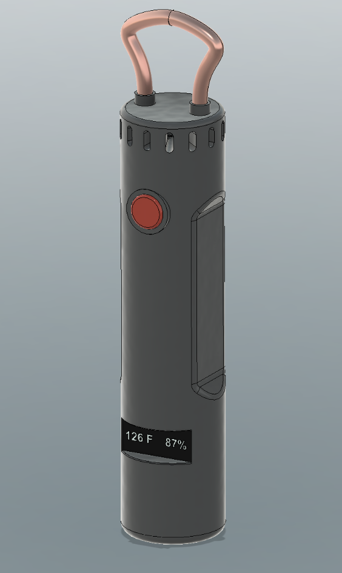
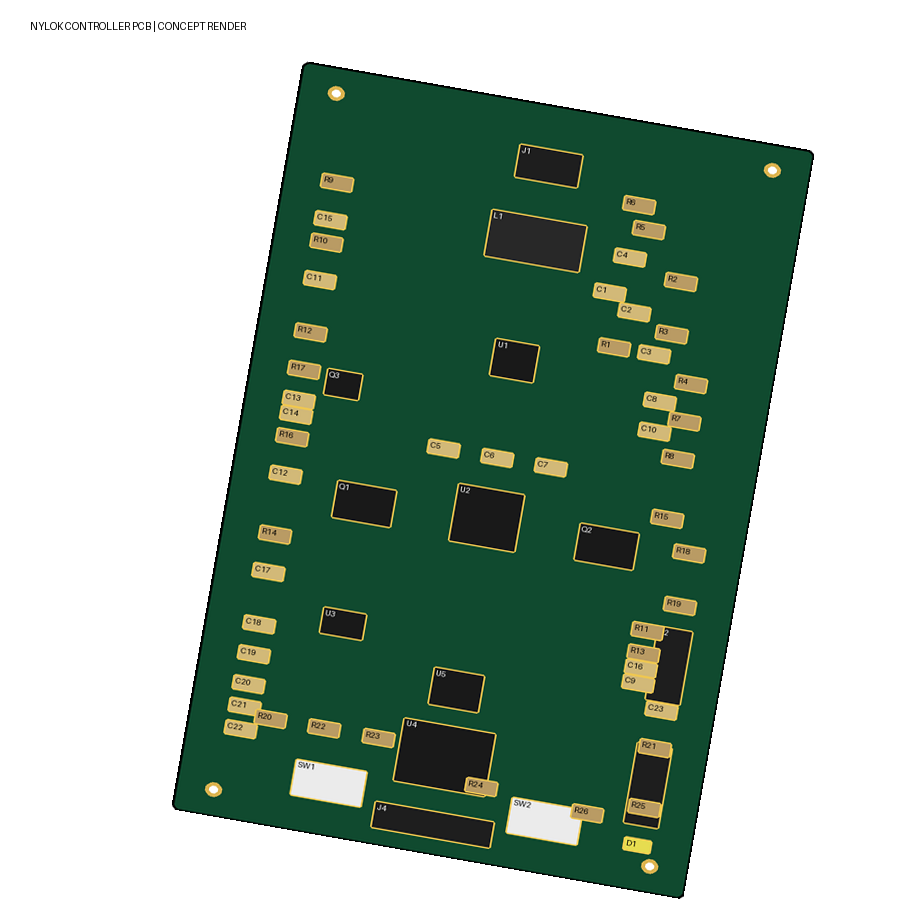

# Nylok Handheld Induction Heater Controller


A two-mode handheld induction-heater controller designed in KiCad for the Notre Dame / Marmon / Nylok Innovate-a-thon.

## Heater product design

<p align="center">
  
</p>

The rendering shows the heater product design. The KiCad files below describe its controller board; heating also requires a separate induction driver and work coil.

**Interested in the CAD files and final product designs? Please contact [Noah Boyd](https://github.com/3nboyd).**

## Full cost analysis

[Full cost analysis](COST_ANALYSIS.md) covers parts, heating calculations, battery runtime, and manufacturing estimates for 5,000 units. The [original Word document](Nylok_Heater_Cost_Analysis.docx) and [Google Drive source](https://docs.google.com/document/d/1d1SXaH8sqosNrCxIEX-nSozUCm1gSHQc/edit) are also available.

| Cost scenario | Basic heater | Two-mode heater with countdown |
|---|---:|---:|
| Prototype parts allocation | $18.06 | $31.37 |
| Estimated manufacturing cost per heater at 5,000 units | $13.14 | $19.14 |

Source prices were checked October 3, 2026. Prototype figures exclude the housing, tools, shipping, and tax; production figures include estimated housing, assembly, functional test, packaging, and reserve. See the full analysis for all assumptions and exclusions.

## Controller PCB



> [!CAUTION]
> **Do not fabricate or energize this board without a qualified electrical and safety review.** See the [review checklist](#safety).

## Overview

The controller uses two protected 18650 cells in series to power a controller board that:

- measures input current;
- provides regulated 5 V and 3.3 V rails;
- controls a switched DC output for an **external zero-voltage-switching (ZVS) induction driver**;
- exposes an Inter-Integrated Circuit (I2C) display connector; and
- provides a Serial Wire Debug (SWD) programming header for the STM32 controller.

The controller switches power to the external ZVS driver, which drives the work coil. Connect the coil to that driver, not directly to connector J2 or the battery.

## Repository contents

```text
.
├── hardware/   KiCad project, schematic, PCB, bill of materials (BOM), and logical net map
├── COST_ANALYSIS.md                 Full readable cost analysis and calculations
├── Nylok_Heater_Cost_Analysis.docx   Original complete cost-analysis document
├── docs/       Engineering study and connection diagram
├── fab/        Fabrication and electrical-review notes
├── renders/    Heater product design and board views
└── scripts/    Repository package checks
```

Key files:

- [`COST_ANALYSIS.md`](COST_ANALYSIS.md): full cost breakdown, calculations, production estimates, and references
- [`Nylok_Heater_Cost_Analysis.docx`](Nylok_Heater_Cost_Analysis.docx): original analysis document
- [`renders/Nylok_Heater_Product_Design.png`](renders/Nylok_Heater_Product_Design.png): actual heater product design rendering
- [`hardware/Nylok_Heater.kicad_pro`](hardware/Nylok_Heater.kicad_pro): KiCad project
- [`hardware/Nylok_Heater.sch`](hardware/Nylok_Heater.sch): legacy KiCad schematic
- [`hardware/Nylok_Heater.kicad_pcb`](hardware/Nylok_Heater.kicad_pcb): nominal 38 mm × 100 mm, two-layer PCB
- [`hardware/BOM.csv`](hardware/BOM.csv): component/value list
- [`hardware/NETS.csv`](hardware/NETS.csv): logical net map
- [`docs/Nylok_Labeled_PCB_and_Connections.png`](docs/Nylok_Labeled_PCB_and_Connections.png): labeled placement and connection diagram
- [`docs/Induction_System_Specification.md`](docs/Induction_System_Specification.md): research, assumptions, calculations, and primary sources

## Open the project

1. Install KiCad 10 or later.
2. Clone the repository:

   ```bash
   git clone https://github.com/3nboyd/Nylok-Heater.git
   cd Nylok-Heater
   ```

3. Open `hardware/Nylok_Heater.kicad_pro`.
4. Allow KiCad to convert the legacy `.sch` file if prompted, but review the resulting diff before committing it.
5. Read [`docs/Induction_System_Specification.md`](docs/Induction_System_Specification.md) before using the design data.

To check the repository package itself:

```bash
python3 scripts/validate_repo.py
```

This script checks file presence, project metadata, BOM/net structure, PCB references, and PNG integrity. It does **not** certify electrical correctness, safety, or fabrication readiness.

## Safety

Induction heating combines high current, resonant switching, strong local heating, rechargeable cells, and potentially hazardous workpiece temperatures. A short circuit, unsuitable component, control fault, inadequate insulation, or incorrect battery protection can cause burns, fire, cell venting, or equipment damage.

A qualified engineer must review the power stage, protection, thermal behavior, creepage/clearance, component ratings, coil/tank behavior, enclosure, battery system, and failure modes before fabrication or use. Early development requires current-limited isolated laboratory power, appropriate PPE, guarding, instrumentation, and fire precautions.

## Contributing

Improvements are welcome. Please read [`CONTRIBUTING.md`](CONTRIBUTING.md) before opening an issue or pull request. Changes to fabrication status must include engineering-review and test evidence.

## License

No open-source license has been selected. The repository is public for review and collaboration, but publication alone does not grant permission to copy, modify, manufacture, or redistribute the design. The owner can add an OSI/OSHWA-compatible license later after choosing the intended terms.
